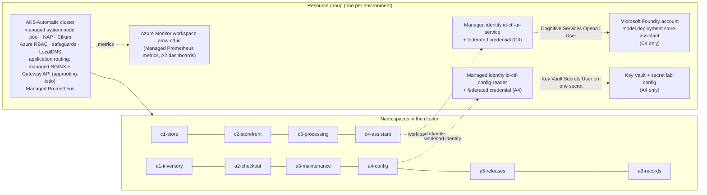

# Architecture

## One environment = one AKS Automatic cluster with every challenge side by side

* **Independent challenges.** Each challenge has its own namespace (C3 also has a cluster-scoped NodePool), so all ten
  can be deployed at once, solved in any order and reset individually: you can move on without finishing one.
* **Azure services only where needed.** C4 adds a Foundry account (key authentication disabled) with a
  `GlobalStandard` deployment; A4 adds a Key Vault (RBAC mode). Both use user-assigned managed identities federated
  with a Kubernetes service account (workload identity) – no secrets anywhere.
* **Images** come from GHCR (aks-store-demo 2.2.0, DocumentDB), MCR (Azure Linux Python/busybox base images for the
  fixtures; scripts are mounted from ConfigMaps, so nothing is built) and Docker Hub (RabbitMQ 4.x).

## The challenge layer

Every approach deploys the same platform, and then each challenge from its folder in
`begin-challenge/challenges/<id>-*`: its Kubernetes objects in `manifests/`, with the challenge's fault in place, and
for A4 its Azure-side settings in `azure.env`.

## Three approaches, one set of manifests

| Concern | Azure CLI – bash | Azure CLI – PowerShell | Terraform |
|---|---|---|---|
| Entry points | `<state>/azure-cli-bash/deploy.sh`, `cleanup.sh` | `<state>/azure-cli-powershell/deploy.ps1`, `cleanup.ps1` | `<state>/terraform` root module |
| Shared code | `shared/azure-cli-bash/lib/*.sh` | `shared/azure-cli-powershell/CtfLab.psm1` | `shared/terraform/modules/lab-platform`, `lab-challenge` |
| AKS Automatic | `az aks create --sku automatic --enable-hosted-system --no-ssh-key --enable-app-routing --enable-gateway-api --enable-app-routing-istio --enable-azure-monitor-metrics --azure-monitor-workspace-resource-id <amw> --workspace-resource-id <law>` | same | `azapi_resource` `Microsoft.ContainerService/managedClusters@2026-05-01` with the equivalent body, plus the Managed Prometheus data collection resources (`monitoring.tf`, `monitoring-rules.tf`) |
| Kubernetes objects | `kubectl apply -f` of rendered manifests | same | `alekc/kubectl` `kubectl_manifest` (server-side apply) per YAML document |
| Kubernetes auth | `az aks get-credentials` + `kubelogin convert-kubeconfig -l azurecli --tenant-id <tenant>` | same | kubectl provider `exec` → `kubelogin get-token --login azurecli --tenant-id <tenant>` |
| State | idempotent re-runs (create-if-missing) | same | Terraform state per folder |

### Deployment sequence

1. Resource group.
2. *Azure Kubernetes Service RBAC Cluster Admin* for the signed-in principal on the resource group – before the
   cluster exists, so it has propagated when the cluster is ready (AKS Automatic disables local accounts).
3. AKS Automatic cluster (10–15 min). The CLI deployments first create the Azure Monitor and Log Analytics
   workspaces it reports to.
4. kubectl credentials; wait until `kubectl auth can-i '*' '*'` succeeds.
5. Challenge-specific Azure services: application routing add-on with managed NGINX and Gateway API (C2; enabled on
   an existing cluster if missing), Managed Prometheus (A2; enabled on an existing cluster if missing), Foundry +
   identity (C4), Key Vault + identity (A4).
6. For each selected challenge: render placeholders → (begin state: delete the challenge's namespace/NodePool) →
   namespace → **setup phase** (objects labelled `kubecon.lab/phase: setup`, e.g. A6's disk and seed Job, waited
   for) → everything else. Within a challenge, objects that pods depend on (Services, ConfigMaps, policies, ...)
   are created before the workloads: by the numbered file names with `kubectl`, and by a separate `workloads` phase
   in the Terraform `lab-challenge` module (Terraform would otherwise create everything in parallel).

### Ingress and Gateway API (C2)

The application routing add-on provides both front doors C2 needs, side by side:

| | Managed NGINX (migration source) | Gateway API (migration target) |
|---|---|---|
| Class | IngressClass `webapprouting.kubernetes.azure.com` | GatewayClass `approuting-istio` |
| Data plane | Shared NGINX controller (`app-routing-system/nginx`, one public IP for all Ingresses) | One Envoy deployment and Service `<gateway>-approuting-istio` per Gateway, in the Gateway's namespace, each with its own public IP |
| Enabled by | `--enable-app-routing` / `az aks approuting enable` / azapi `ingressProfile.webAppRouting` | `--enable-gateway-api --enable-app-routing-istio` / azapi `ingressProfile.gatewayAPI` + `gatewayAPIImplementations.appRoutingIstio` |

The storefront's public name `ctf-store-<id>.<region>.cloudapp.azure.com` is an Azure DNS label on a load
balancer IP, requested with the Service annotation `service.beta.kubernetes.io/azure-dns-label-name` (for a
Gateway: `spec.infrastructure.annotations`). In the begin state no Service carries it; the cutover adds it to the
gateway.

### Monitoring (A2)

Every approach keeps monitoring in the lab resource group:

* **Azure CLI:** `az aks create --sku automatic` turns on Managed Prometheus and Container Insights itself. The
  scripts pass an Azure Monitor workspace (`amw-ctf-<id>`) and a Log Analytics workspace (`law-ctf-<id>`) they
  create in the lab resource group; the CLI adds the data collection endpoint/rule (`MSProm-…`, `MSCI-…`) and the
  recording rule groups there too. On an existing cluster without metrics, deploying A2 runs
  `az aks update --enable-azure-monitor-metrics` with the lab workspace. (Clusters created by earlier versions of the
  scripts report to `DefaultResourceGroup-<region>`.)
* **Terraform:** the cluster body enables the metrics agent (`azureMonitorProfile.metrics`); `monitoring.tf` adds the
  Azure Monitor workspace, data collection endpoint, rule and association, and `monitoring-rules.tf` the Node,
  Kubernetes and UX recording rules (from the official Terraform onboarding template). No Container Insights (logs).

Participants use the metrics through the cluster's **Monitoring → Dashboards with Grafana** page in the Azure portal
(no Grafana instance to deploy). Like the cluster's `MC_…` node resource group, an Azure Monitor workspace has a
managed resource group (`MA_<workspace>_<region>_managed`) that Azure creates and deletes together with it.

### Placeholders

Manifests contain a few `__TOKEN__` placeholders, replaced at deploy time by every approach:

| Placeholder | Value |
|---|---|
| `__AZURE_OPENAI_ENDPOINT__` | `https://aoai-ctf-<id>.openai.azure.com/` |
| `__AZURE_OPENAI_DEPLOYMENT__` / `__AZURE_OPENAI_MODEL_NAME__` | `store-assistant` / `gpt-6-luna` |
| `__AI_SERVICE_CLIENT_ID__`, `__CONFIG_READER_CLIENT_ID__` | client IDs of the managed identities |
| `__KEY_VAULT_URI__` | `https://kv-ctf-<id>.vault.azure.net/` |
| `__STOREFRONT_DNS_LABEL__` / `__STOREFRONT_HOSTNAME__` | `ctf-store-<id>` / `ctf-store-<id>.<region>.cloudapp.azure.com` |

### Naming

| Resource | Name |
|---|---|
| Resource group | `rg-kubecon-ctf-begin-{bash,pwsh,tf}` (override with options) |
| AKS cluster / kubectl context | `aks-` + resource group without `rg-` |
| Foundry account, Key Vault, storefront DNS label | `aoai-ctf-<id>`, `kv-ctf-<id>`, `ctf-store-<id>` |
| Azure Monitor / Log Analytics workspaces | `amw-ctf-<id>` / `law-ctf-<id>` (Log Analytics: Azure CLI deployments only) |
| Managed identities | `id-ctf-ai-service`, `id-ctf-config-reader` |

`<id>` = the first 6 hex characters of `sha1("<subscription-id>/<resource-group>")` – identical in bash,
PowerShell and Terraform, so every approach finds the same globally unique names for a given resource group.

## AKS Automatic behaviours the lab accounts for

* **Deployment safeguards (Enforce, can't be lowered):** every container has readiness/liveness probes and explicit
  requests/limits ≥ 100m CPU / 100Mi; multi-replica Deployments set a topology spread; no `:latest` tags. Bare pods
  without resource requests are denied – see the troubleshooting tips in [begin-challenge/README.md](../begin-challenge/README.md).
* **Pod Security Standards (baseline):** no privileged containers or host access (`kubectl debug` needs
  `--profile=baseline` or `restricted`).
* **LocalDNS:** pods resolve through a node-local cache (`169.254.10.11`). The cache serves stale answers
  (`serveStale: Immediate`, up to 1 hour). Right after a Service is re-created – every challenge reset – the first
  lookup on a node can return the Service's **previous** ClusterIP. nginx (store-front, store-admin) resolves its
  upstreams only at startup and would keep proxying to a dead address, so those Deployments run a `warm-dns-cache`
  init container that looks the upstreams up first.
* **Node auto-provisioning:** workload nodes appear on demand; C3 adds a dedicated NodePool. Empty nodes are
  consolidated (C3's pool after 10 minutes), and finished pods on them are garbage-collected with the node.
