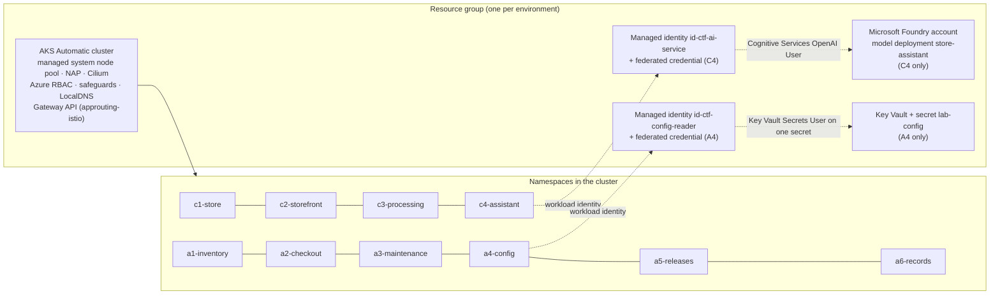

# Architecture

## One environment = one AKS Automatic cluster with every challenge side by side

* **Independent rounds.** Each challenge has its own namespace (C3 also has a cluster-scoped NodePool), so all ten
  can be deployed at once, solved in any order and reset individually – matching the design doc's "one lab instance
  runs all rounds" and the review comment that participants must be able to move on without finishing a round.
* **Azure services only where needed.** C4 adds a Foundry account (key authentication disabled) with a
  `GlobalStandard` deployment; A4 adds a Key Vault (RBAC mode). Both use user-assigned managed identities federated
  with a Kubernetes service account (workload identity) – no secrets anywhere.
* **Images** come from GHCR (aks-store-demo 2.2.0, DocumentDB), MCR (Azure Linux Python/busybox base images for the
  fixtures; scripts are mounted from ConfigMaps, so nothing is built) and Docker Hub (RabbitMQ 4.x).

## Begin vs. end state

Both states deploy the same platform; only the challenge layer differs:

* `begin-challenge/challenges/<id>-*/manifests` – the seeded fault.
* `challenge-end-state/challenges/<id>-*/manifests` – the result of the expected repair.
* A4's fault is Azure-side (the federated credential subject), stored in each state's `challenges/a4-*/azure.env`.

`git diff --no-index` between the two `manifests` folders of a challenge shows the fix exactly.

## Three approaches, one set of manifests

| Concern | Azure CLI – bash | Azure CLI – PowerShell | Terraform |
|---|---|---|---|
| Entry points | `<state>/azure-cli-bash/deploy.sh`, `cleanup.sh` | `<state>/azure-cli-powershell/deploy.ps1`, `cleanup.ps1` | `<state>/terraform` root module |
| Shared code | `shared/azure-cli-bash/lib/*.sh` | `shared/azure-cli-powershell/CtfLab.psm1` | `shared/terraform/modules/lab-platform`, `lab-challenge` |
| AKS Automatic | `az aks create --sku automatic --enable-hosted-system --no-ssh-key --enable-gateway-api --enable-app-routing-istio` | same | `azapi_resource` `Microsoft.ContainerService/managedClusters@2026-05-01` with the equivalent body |
| Kubernetes objects | `kubectl apply -f` of rendered manifests | same | `alekc/kubectl` `kubectl_manifest` (server-side apply) per YAML document |
| Kubernetes auth | `az aks get-credentials` + `kubelogin convert-kubeconfig -l azurecli` | same | kubectl provider `exec` → `kubelogin get-token --login azurecli` |
| State | idempotent re-runs (create-if-missing) | same | Terraform state per folder |

### Deployment sequence

1. Resource group.
2. *Azure Kubernetes Service RBAC Cluster Admin* for the signed-in principal on the resource group – before the
   cluster exists, so it has propagated when the cluster is ready (AKS Automatic disables local accounts).
3. AKS Automatic cluster (10–15 min).
4. kubectl credentials; wait until `kubectl auth can-i '*' '*'` succeeds.
5. Challenge-specific Azure services: Gateway API check (C2), Foundry + identity (C4), Key Vault + identity (A4).
6. For each selected challenge: render placeholders → (begin state: delete the challenge's namespace/NodePool) →
   namespace → **setup phase** (objects labelled `kubecon.lab/phase: setup`, e.g. A6's disk and seed Job, waited
   for) → everything else. Within a challenge, objects that pods depend on (Services, ConfigMaps, policies, ...)
   are created before the workloads: by the numbered file names with `kubectl`, and by a separate `workloads` phase
   in the Terraform `lab-challenge` module (Terraform would otherwise create everything in parallel).

Monitoring differs by approach: `az aks create --sku automatic` enables Container Insights and Managed Prometheus
client-side and, without `--workspace-resource-id`, creates a Log Analytics workspace in
`DefaultResourceGroup-<region>` (outside the lab resource group; not removed by the cleanup scripts). The Terraform
(azapi) cluster has no monitoring add-ons. No challenge depends on monitoring.

### Placeholders

Manifests contain a few `__TOKEN__` placeholders, replaced at deploy time by every approach:

| Placeholder | Value |
|---|---|
| `__AZURE_OPENAI_ENDPOINT__` | `https://aoai-ctf-<id>.openai.azure.com/` |
| `__AZURE_OPENAI_DEPLOYMENT__` / `__AZURE_OPENAI_MODEL_NAME__` | `store-assistant` / `gpt-6-luna` (C4's begin state names the retired deployment `store-assistant-gpt41` literally) |
| `__AI_SERVICE_CLIENT_ID__`, `__CONFIG_READER_CLIENT_ID__` | client IDs of the managed identities |
| `__KEY_VAULT_URI__` | `https://kv-ctf-<id>.vault.azure.net/` |
| `__STOREFRONT_DNS_LABEL__` / `__STOREFRONT_HOSTNAME__` | `ctf-store-<id>` / `ctf-store-<id>.<region>.cloudapp.azure.com` |

### Naming

| Resource | Name |
|---|---|
| Resource group | `rg-kubecon-ctf-{begin,end}-{bash,pwsh,tf}` (override with options) |
| AKS cluster / kubectl context | `aks-` + resource group without `rg-` |
| Foundry account, Key Vault, storefront DNS label | `aoai-ctf-<id>`, `kv-ctf-<id>`, `ctf-store-<id>` |
| Managed identities | `id-ctf-ai-service`, `id-ctf-config-reader` |

`<id>` = the first 6 hex characters of `sha1("<subscription-id>/<resource-group>")` – identical in bash,
PowerShell and Terraform, so every approach finds the same globally unique names for a given resource group.

## AKS Automatic behaviours the design accounts for

* **Deployment safeguards (Enforce, can't be lowered):** every container has readiness/liveness probes and explicit
  requests/limits ≥ 100m CPU / 100Mi; multi-replica Deployments set a topology spread; no `:latest` tags. Faults are
  chosen so safeguards neither block nor "auto-fix" them (PodDisruptionBudgets are not checked). Bare pods without
  resource requests are denied – see the troubleshooting tips in [begin-challenge/README.md](../begin-challenge/README.md).
* **Pod Security Standards (baseline):** no privileged containers or host access (`kubectl debug` needs
  `--profile=baseline` or `restricted`).
* **LocalDNS:** pods resolve through a node-local cache (`169.254.10.11`). Two consequences, both verified on Azure:
  * Azure CNI powered by Cilium treats that traffic as the `host` entity, which Kubernetes NetworkPolicies can't
    select – relevant for A1.
  * The cache serves stale answers (`serveStale: Immediate`, up to 1 hour). Right after a Service is re-created –
    every challenge reset – the first lookup on a node can return the Service's **previous** ClusterIP. nginx
    (store-front, store-admin) resolves its upstreams only at startup and would keep proxying to a dead address,
    so those Deployments run a `warm-dns-cache` init container that looks the upstreams up first.
* **Node auto-provisioning:** workload nodes appear on demand; C3 adds a dedicated NodePool. Empty nodes are
  consolidated (C3's pool after 10 minutes), and finished pods on them are garbage-collected with the node.
* **Foundry model access:** requests addressed to a bare model name (for example `gpt-6-luna`) are answered even
  without a deployment of that name; only unknown names return `DeploymentNotFound` – relevant for C4.
