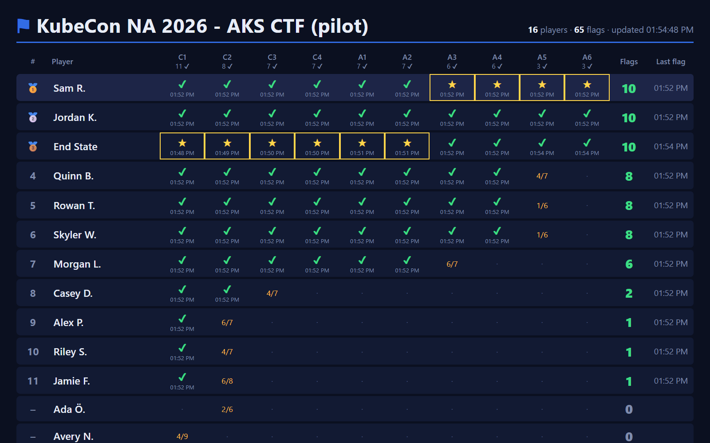
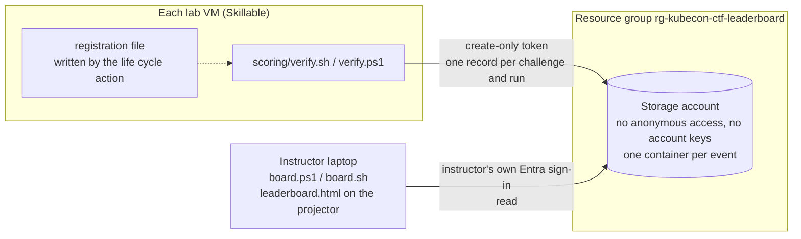

# Leaderboard – live scores for the lab room

An optional, projected leaderboard for the event. Every time an attendee runs `scoring/verify.sh` or
`./scoring/verify.ps1` on their lab VM, the result of each checked challenge is recorded on a central leaderboard;
the instructor's laptop shows who has captured which flag, live, on the projector.





No server or app runs anywhere: the verify scripts write small records straight to Azure Blob Storage, and the board
is a static page the instructor opens locally.

## Security

The storage account is **not** an open blob: anonymous access and account keys are both disabled, it accepts HTTPS
(TLS 1.2+) only, and every request needs either a scoped, expiring token signed with Microsoft Entra ID or an Entra
sign-in.

| Who | How they get in | Can | Can't |
|---|---|---|---|
| Lab VMs (attendees) | A **create-only** token (user delegation SAS) for one container, valid for at most 7 days, HTTPS only; optionally locked to the lab provider's outbound IPs (`-AllowedIp` / `--ip`) | add a result record | read, list, overwrite or delete anything |
| Instructor laptop | The instructor's own Entra sign-in (`az login`, Storage Blob Data Reader or Contributor on the account) | read the results | – no read token exists at all |

* **Kill switch:** `./leaderboard/cleanup.ps1 -RevokeOnly` (or `cleanup.sh --revoke-only`) invalidates every token at
  once; tokens also expire on their own.
* **Retention:** a lifecycle rule deletes every record 14 days (`-RetentionDays`) after it was written; delete the whole
  leaderboard after the event with `cleanup`.
* **Data stored:** a player ID (the Skillable user ID – an opaque number), the name shown on the board (first name and
  last initial – no e-mail address), the challenge, pass/fail and the number of checks passed.

Verified on Azure on 2026-11-03 with a token issued by `setup`: creating a record → 201; overwriting, reading,
listing and deleting with the token → 403; anonymous requests → 409 `PublicAccessNotPermitted`; the account key →
rejected (key-based authentication not permitted); a token locked to another IP → 403; a revoked token → 403
`AuthenticationFailed`.

**Accepted risks** (fine for a lab whose leaderboard is deleted after the event):

* The token is visible on the attendee's VM. Someone could post fake results, junk, or an offensive name to the
  projected board. The board only shows names as plain text (letters, digits, spaces, `. ' -`, 24 characters), the
  instructor can hide or delete players (see *During the event*), and you can spot-check the top finishers with
  `scoring/verify` before handing out prizes.
* Names on a projector are personal data – tell attendees in the lab introduction that the leaderboard shows their
  first name and last initial, and that `--no-report` / `-NoReport` keeps a run off the board.
* The token must never be committed – the repository is public. `setup` writes it to `.lab/` (ignored by git) and into
  the Skillable life cycle action, nowhere else.
* If your organization's policy disables public network access on storage accounts, lab VMs outside your network can't
  reach it; the alternative is a small API with a managed identity in front of private storage (not built).

There is no Terraform variant: the token is signed with your Entra ID by the Azure CLI, which Terraform can't do.

## Before the event

### 1. Create the leaderboard and a token (organizer, ~2 minutes)

```powershell
./leaderboard/setup.ps1 -Container kubecon-na-2026 -TokenHours 48
```

```bash
./leaderboard/setup.sh --container kubecon-na-2026 --hours 48
```

| Option (PowerShell / bash) | Default | |
|---|---|---|
| `-ResourceGroup` / `-g` | `rg-kubecon-ctf-leaderboard` | its own resource group (deleted by `cleanup`) |
| `-Location` / `-l` | `westus3` | |
| `-StorageAccount` / `--account` | `ctflb` + 8 hex characters from subscription and resource group | globally unique |
| `-Container` / `--container` | `ctf` | one container per event or pilot |
| `-TokenHours` / `--hours` | `48` | 1–168: issue the token the day before the event |
| `-AllowedIp` / `--ip` | – | only accept submissions from this IP or range (ask Skillable for their outbound IPs) |
| `-RetentionDays` / `--retention-days` | `14` | records are deleted automatically after this |

The script enforces the security settings, gives you Storage Blob Data Contributor on the account, creates the
container, issues the token and **tests it** (it must be able to record an entry and must not be able to read one). It
writes `.lab/leaderboard/` (ignored by git): `settings.env`, `submit-url.txt` and the two Skillable life cycle actions
with the token filled in. Re-running it is safe and issues a fresh token.

`setup` creates the leaderboard in the Azure CLI's current subscription and records it in `settings.env`; `board`
and `cleanup` then use that recorded subscription, whichever subscription is current later (override with
`-Subscription` / `--subscription`). Running `setup` with a different current subscription creates a new
leaderboard there and replaces the local files of the old one.

### 2. Register every lab with a Skillable life cycle action

In the lab profile: **Life Cycle Actions → Add**

* Event **Running**, action **Execute Script in Virtual Machine**, language **PowerShell** (Windows VM) or **Bash**
  (Linux VM), **Blocking: No**, **Error action: Ignore** – the lab works without the leaderboard.
* Script: the contents of `.lab/leaderboard/skillable-lca-windows.ps1` (or `skillable-lca-linux.sh`) – not the
  templates in `leaderboard/skillable/`, which don't contain the token.

When a lab starts, Skillable replaces `@lab.User.Id`, `@lab.User.FirstName` and `@lab.User.LastName`, and the script
writes `%ProgramData%\kubecon-ctf\leaderboard.env` (Linux: `/etc/kubecon-ctf/leaderboard.env`). The Skillable user ID
keeps a player's flags when they relaunch the lab; use `@lab.LabInstance.GlobalId` instead if attendees share a
Skillable account. **Each time you re-run `setup`, paste the new copy into the lab profile.** In the Skillable pilot,
check one attendee whose name has accents.

Lab VMs need outbound HTTPS to `<account>.blob.core.windows.net`, and `curl` for `verify.sh` – no Azure role, no
Azure CLI and no sign-in.

### 3. Prepare the instructor laptop

The Azure CLI and `az login` with **Storage Blob Data Reader** (or Contributor) on the storage account. Whoever ran
`setup` already has Contributor; to add another instructor:

```bash
az role assignment create --role "Storage Blob Data Reader" --assignee <user@contoso.com> \
  --scope $(az storage account show -n <account> -g rg-kubecon-ctf-leaderboard --query id -o tsv)
```

On a laptop that didn't run `setup`, pass `-StorageAccount`/`-Container` (`--account`/`--container`) to the board,
and `-Subscription` (`--subscription`) if that laptop's current Azure CLI subscription is in another tenant.

### 4. Rehearse

```powershell
./tests/leaderboard/simulate-players.ps1 -Players 15      # demo players through the same reporting code and token
./leaderboard/board.ps1
az storage blob delete-batch --account-name <account> --source <container> --pattern 'results/demo-*' --auth-mode login
```

## During the event

```powershell
./leaderboard/board.ps1 -Challenges c1,c2,a2,c4 -Title 'KubeCon NA 2026 - AKS Capture the Flag' -Start '2026-11-10 09:00'
```

```bash
./leaderboard/board.sh --challenges c1,c2,a2,c4 --title 'KubeCon NA 2026 - AKS Capture the Flag' --start 2026-11-10T09:00
```

The script reads the results every 10 seconds (`-RefreshSeconds` / `--refresh`) and opens the page; press **F11** for
full screen. `-Challenges` sets the columns and what counts (default: all ten), `-Start` shows capture times as time
since the start, `-MaxRows` / `--max-rows` the number of players shown (default 20). If the script stops or can't read
the results, the page says so.

**Scoring.** A flag is captured the first time `verify` passes a challenge – a later failing run doesn't take it away.
Players rank by flags, then by who reached that number first (server time). ★ marks the first player to capture each
challenge; an amber `6/9` shows the latest check result for a challenge not captured yet. Runs with `--quick` / `-Quick`
or `--no-report` / `-NoReport` are not recorded.

**What attendees see** in the verify output:

```text
Leaderboard: recording results for 'Brian B.' (--no-report to skip)
  >> leaderboard: flag recorded for Brian B.
  >> leaderboard: progress recorded for Brian B. (6/9 checks)
  >> leaderboard: not recorded (HTTP 403 AuthenticationFailed) - your result above still stands; tell a proctor if this keeps happening
```

**Moderation.** Double-click a player to hide them on this screen (U shows hidden players again). To remove a player's
records for good (hover over a name to see the player ID):

```bash
az storage blob delete-batch --account-name <account> --source <container> --pattern 'results/<player-id>/*' --auth-mode login
```

**Kill switch.** `./leaderboard/cleanup.ps1 -RevokeOnly` (or `./leaderboard/cleanup.sh --revoke-only`) stops all
submissions immediately; the board keeps showing what is there. To accept results again, run `setup` and update the life
cycle action.

## After the event

```powershell
./leaderboard/cleanup.ps1          # revokes the tokens, deletes the resource group and the local files (asks first)
```

```bash
./leaderboard/cleanup.sh
```

`cleanup` only deletes a resource group that `setup` created (tag `purpose=kubecon-ctf-leaderboard`), in the
subscription recorded in `settings.env`. If it can't check the resource group (for example a sign-in problem), it
stops without deleting anything, including the local files.

## Trying it outside Skillable

Register your own machine (it gets a random player ID), run a check, and leave again:

```powershell
./leaderboard/join.ps1 -Name 'Brian B.'                  # uses .lab/leaderboard/submit-url.txt; or -SubmitUrl '<url>'
./scoring/verify.ps1 -Challenges c1
./leaderboard/join.ps1 -Remove
```

```bash
./leaderboard/join.sh --name "Brian B."                  # or --url '<url>'
scoring/verify.sh --challenges c1
./leaderboard/join.sh --remove
```

For a single run, set `CTF_LEADERBOARD_URL`, `CTF_PLAYER_ID` and `CTF_PLAYER_NAME` instead.

## Reference

**Registration lookup** (first match wins): the environment variables above → the file in `CTF_LEADERBOARD_CONFIG` →
`~/.kubecon-ctf/leaderboard.env` (`join`) → `%ProgramData%\kubecon-ctf\leaderboard.env` or
`/etc/kubecon-ctf/leaderboard.env` (Skillable). The file is `KEY=value` lines (`CTF_LEADERBOARD_URL`, `CTF_PLAYER_ID`,
`CTF_PLAYER_NAME`); it is parsed, never executed. Machines without a registration don't report anything.

**Records.** One block blob per challenge and run: `results/<player-id>/<challenge>/<UTC time>-<random>.json`, with
the display name (base64), `passed` and `checks` as blob metadata and the same details as JSON in the body. The board
uses only the blob name, metadata and the server's creation time, so client clocks don't matter and record contents
are never rendered. `setup` also writes a `health/` probe that the board ignores.

| File | Purpose |
|---|---|
| `setup.ps1` / `setup.sh` | create or refresh the leaderboard, issue and test a token |
| `board.ps1` / `board.sh` | read the results (Entra sign-in) and keep the projector page up to date |
| `leaderboard.html` | the projector page (static, no external resources) |
| `cleanup.ps1` / `cleanup.sh` | kill switch (`-RevokeOnly`) and deletion |
| `join.ps1` / `join.sh` | register a machine outside Skillable |
| `skillable/lca-windows.ps1`, `skillable/lca-linux.sh` | life cycle action templates (setup fills in the token) |
| `../scoring/lib/Leaderboard.ps1`, `../scoring/lib/leaderboard.sh` | reporting code used by the verify scripts |
| `../tests/leaderboard/simulate-players.ps1` | demo players for a rehearsal |
